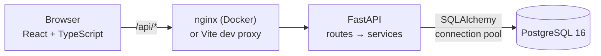
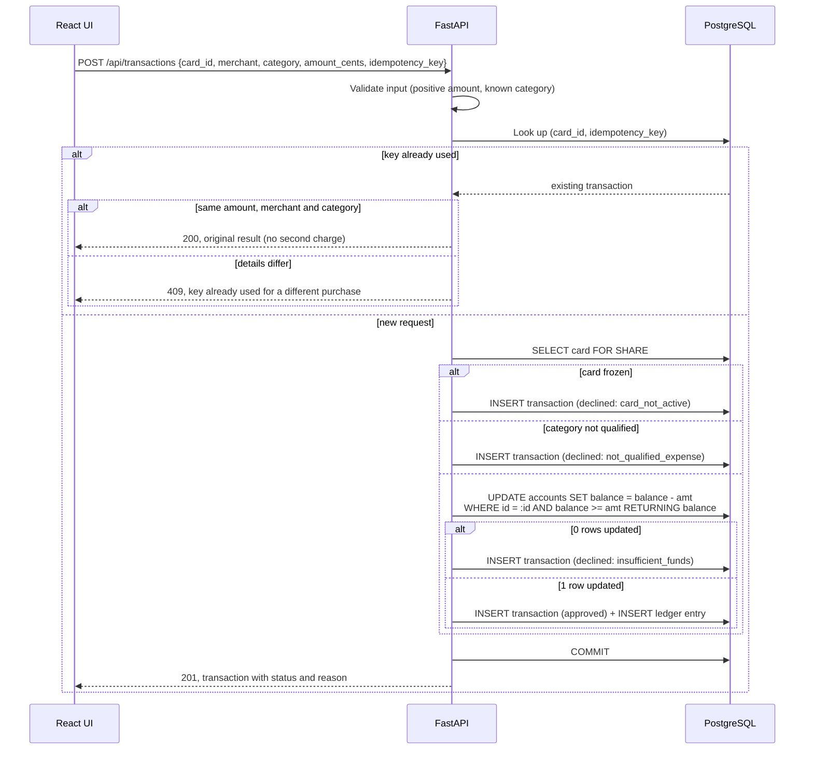
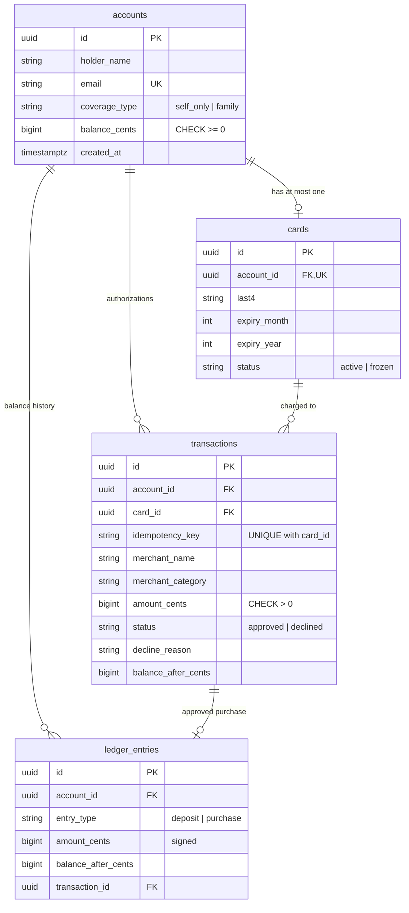

# Architecture

## System architecture



Three pieces, each with one job:

| Layer | Responsibility |
| --- | --- |
| **React UI** (`frontend/`) | Forms for every core flow, a concurrency test panel, and history tables. Holds no business rules; it renders what the API decides. |
| **FastAPI** (`backend/app/`) | Validation (Pydantic), business rules (`services/`), and HTTP mapping (`main.py`). Endpoints are synchronous and run in FastAPI's thread pool, so concurrent requests really do run at the same time. |
| **PostgreSQL** | System of record. Enforces the invariants that must never break (non-negative balance, one card per account, unique idempotency keys, append-only ledger), so correctness doesn't rely on application code alone. |

The browser only talks to one origin. In Docker, nginx serves the built UI and forwards `/api` to the backend; in development, Vite's proxy does the same.

Inside the backend, routes stay thin and call services:

```
app/
  main.py        routes: parse request → call service → shape response
  schemas.py     request/response validation (amounts are integer cents)
  domain.py      business configuration: merchant categories, IRS limits, enums
  services/
    accounts.py      create, deposit (with annual contribution limit)
    cards.py         issue, freeze/unfreeze
    transactions.py  card authorization: the concurrency-critical path
  models.py      tables, constraints, indexes
```

## Request flow: processing a purchase



Ordering choices:

- **Cheap checks come before the debit.** A frozen card or a non-qualified merchant is declined without ever touching the balance, so it can't hold a lock on the account.
- **A decline is a 201, not an HTTP error.** Like a card network, "declined" is a normal business outcome with a reason code. HTTP errors are reserved for bad requests (422), unknown resources (404) and conflicts (409).
- **Every attempt is recorded**, including declines, so there's an audit trail of what was tried and why it failed.

## Data model



**Accounts** hold the holder's details, HDHP coverage type (which sets the IRS limit) and the current balance. The balance is stored, not recomputed on each read, so the authorization path is a single-row update.

**Cards** are virtual debit cards, one per account (enforced by a unique constraint). Only the last four digits are stored. A real issuer keeps the full card number in a PCI-scoped vault and gives the application a token; the card `id` plays that token role here.

**Transactions** record every authorization attempt with its outcome and, if declined, the reason.

**Ledger entries** are the append-only history of every balance change: deposits are positive, purchases negative, and each row records the balance after it. A database trigger rejects `UPDATE` and `DELETE` on this table.

### Decisions behind the model

- **Money is integer cents (`BIGINT`) everywhere**, including the API. Floats can't represent amounts like $0.10 exactly. The UI parses dollar strings into cents without floating-point math.
- **Balance + ledger, both.** The stored balance makes authorization fast and lockable; the ledger makes it auditable. The invariant `balance_cents = SUM(ledger.amount_cents)` is asserted in the tests, including after concurrent runs.
- **Constraints live in the database.** `balance_cents >= 0`, positive amounts, valid statuses, decline reason present if and only if declined, one card per account, unique idempotency keys. If application code ever has a bug, Postgres refuses the bad write.
- **Qualified expenses are an allowlist of merchant categories** (`domain.py`). Card networks already classify merchants by category code (MCC), so classifying by category mirrors how real HSA cards work. A category not on the list is not qualified, which is the safe default for tax-advantaged money. Matching on merchant names was rejected because it's trivially fooled.
- **The IRS annual contribution limit is enforced on deposits** (2026: $4,400 self-only, $8,750 family). The limits are 2026 constants, so this is a 2026 simulation; a real system would key limits by tax year (and allow prior-year contributions until the tax deadline).
- **UUID primary keys**, so IDs in URLs aren't sequential and can't be trivially enumerated. That is not access control: without authentication, anyone who has an ID can use it (see *What I'd improve*).

## Concurrency handling

The required scenario: balance $100, purchases of $80 and $50 arrive at the same time. Exactly one may be approved, and the balance must never go negative.

### The approach: one atomic conditional update

```sql
UPDATE accounts
SET balance_cents = balance_cents - :amount
WHERE id = :account_id AND balance_cents >= :amount
RETURNING balance_cents;
```

The funds check and the debit are a single statement, so there's no gap between "check" and "write" for another request to slip into. Under Postgres's default `READ COMMITTED` isolation:

1. Transaction A's `UPDATE` takes a row lock on the account.
2. Transaction B's `UPDATE` on the same row waits for that lock.
3. When A commits, Postgres re-evaluates B's `WHERE` clause against the **new** row ($20 left). `20 >= 50` is false, so B updates zero rows.
4. Zero rows returned means insufficient funds: B is recorded as declined.

Whichever request reaches the row first wins; the outcome is always one approval and a non-negative balance.

### Why not the obvious version

The intuitive implementation reads the balance, checks it in Python, then writes `balance - amount`. Two requests can both read $100, both pass the check, and both write. That's a classic lost update: $130 approved against $100.

I verified this isn't hypothetical. I temporarily replaced the atomic update with that read-check-write version, and the concurrency test failed immediately (both purchases approved). Note that the `CHECK (balance_cents >= 0)` constraint did **not** catch it: each request wrote a positive balance, so money was double-spent without the balance ever going negative. That's why the guarantee has to come from the atomic update itself; the constraint is a backstop, not the mechanism.

### Other concurrency cases

| Scenario | Mechanism |
| --- | --- |
| Two purchases race on one account | Atomic conditional `UPDATE` (above) |
| A client retries the same purchase (network timeout, double click) | Unique `(card_id, idempotency_key)`. If two identical requests race past the initial lookup, the unique index lets only one insert win; the loser's transaction rolls back, **which also undoes its debit**, and it returns the winner's result. Charged once. Reusing a key with a *different* amount or merchant is rejected with 409 rather than silently returning the old result. |
| Concurrent deposits near the annual limit | The limit check needs a sum of this year's deposits, so the deposit path locks the account row with `SELECT ... FOR UPDATE`. Deposits on one account run one at a time and can't jointly exceed the limit. |
| A card is frozen while a purchase is in flight | Authorization reads the card with `FOR SHARE`; a freeze (`FOR UPDATE`) waits for in-flight authorizations to finish, and later ones see the frozen status. |
| Two "issue card" clicks at once | Unique constraint on `cards.account_id`; the second gets 409. |

Locks are always taken in the same order (card, then account), so these paths can't deadlock each other.

### How it's tested

`backend/tests/test_concurrency.py` runs requests on separate threads, each with its own database connection, released at the same instant by a barrier:

- The spec's $80/$50-against-$100 case, repeated 25 times: exactly one approved every time, and the ledger always matches the balance.
- 30 simultaneous $10 purchases against $100: exactly 10 approved, balance exactly $0.
- 10 simultaneous retries with the same idempotency key: one transaction, one charge.
- 10 simultaneous $500 deposits against the $4,400 limit: exactly 8 succeed.
- Purchases racing deposits: balance always equals the ledger sum.

The same race was also run 20 times over real HTTP through the proxy; both orderings occurred (sometimes $80 won, sometimes $50), confirming the requests genuinely raced.

## Design tradeoffs

| Decision | Chosen | Alternative | Why |
| --- | --- | --- | --- |
| Concurrency control | Atomic conditional `UPDATE` | `SELECT ... FOR UPDATE` then check in Python | Same correctness, but the check can't be accidentally separated from the write, and the lock is held for one statement instead of across application code. Deposits do use `FOR UPDATE`, because their check (sum of deposits) can't be expressed in one `UPDATE`. |
| | | `SERIALIZABLE` isolation | Also correct, but conflicts surface as serialization errors that need retry logic. The conditional update gives a clean decline instead of a retry loop. |
| Balance storage | Stored balance + append-only ledger | Ledger only, balance computed on read | Computing the balance under concurrency would require locking or summing the ledger on every purchase. The stored balance is the lockable fast path; the ledger is the audit trail. |
| Qualification | Merchant category allowlist | Real 4-digit MCCs; per-item (IIAS) receipts | Readable for reviewers and easy to extend. Real HSA cards also verify item-level detail at pharmacies and big-box stores, which is out of scope here. |
| Declines | Recorded, returned as 201 | HTTP 4xx | Matches card-network semantics, and keeps a full audit trail. |
| Database | PostgreSQL | SQLite | SQLite serializes all writes, so it would hide concurrency bugs rather than handle them. Tests run against real Postgres for the same reason. |
| API style | Synchronous FastAPI endpoints | `async` + async driver | The workload is DB-bound and simple; the thread pool gives true concurrency with less complexity. |

## What I'd improve with more time

- **Authentication and authorization.** Right now any caller can act on any account. Real users would only see their own accounts. For that reason the Docker setup binds every port to `127.0.0.1`, so the unauthenticated app isn't reachable from the network.
- **Authorization holds and settlement.** Real card payments place a hold, then settle (sometimes for a different amount) or expire. This model debits immediately.
- **Item-level qualification (IIAS)** for mixed merchants, and receipts/substantiation for audits.
- **Catch-up contributions** for holders 55+, and limits that account for mid-year coverage changes.
- **Card lifecycle:** replacement, cancellation, spend limits, and real PAN tokenization via a vault.
- **Observability:** structured logs with a request ID, metrics on decline reasons and lock wait times.
- **Pagination** on history endpoints (currently capped at 100 rows).
